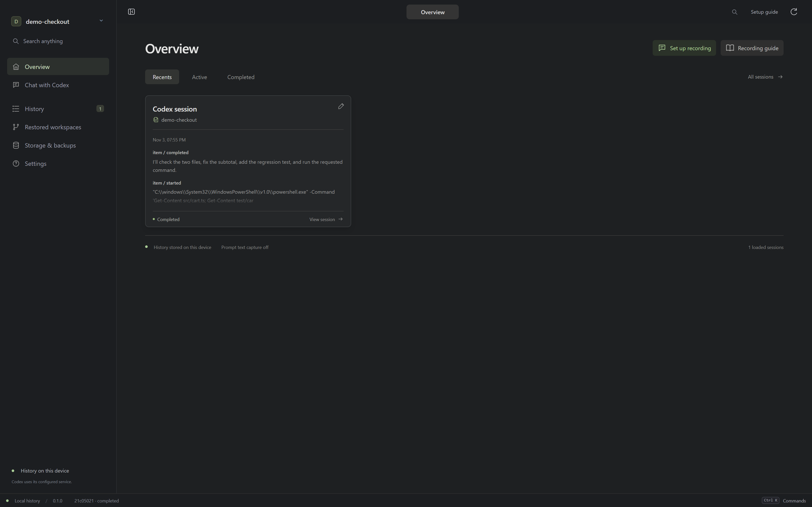
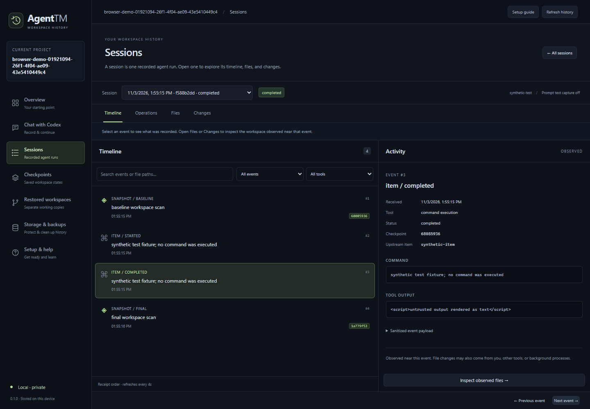
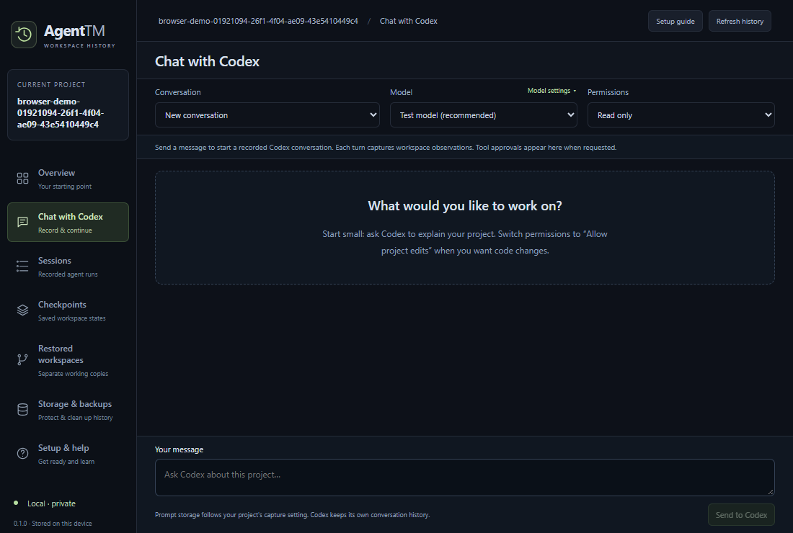
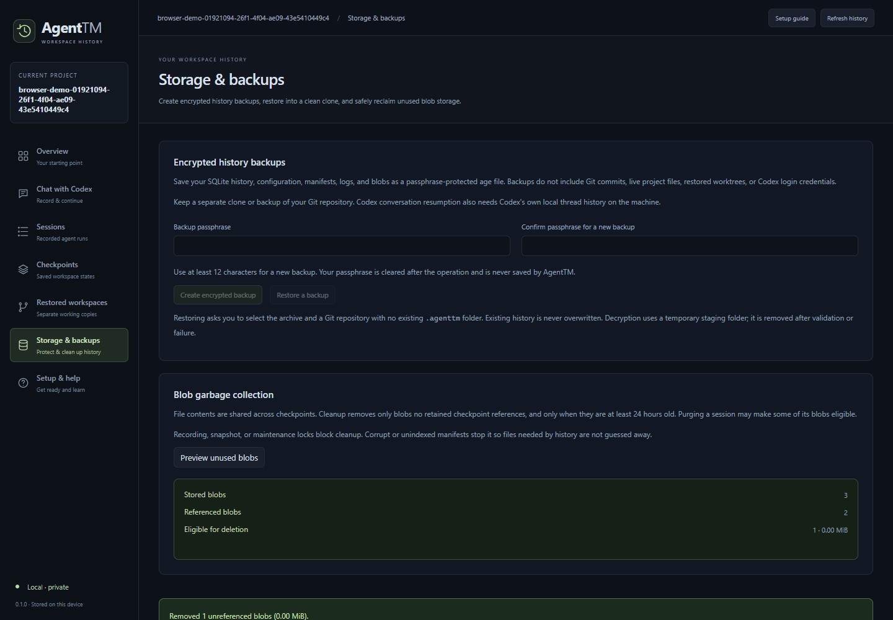

# Agent Time Machine (AgentTM)

A local debugging tool that records managed Codex sessions and workspace checkpoints so you can inspect changes and restore earlier files into an isolated Git worktree.

**Public source, proprietary license.** This repository remains public, but
AgentTM is not offered under an open-source license. See [LICENSE](LICENSE) for
official binary-use permissions and restrictions on original implementation reuse.
Third-party licenses and GitHub's public-repository terms remain in force. See
[licensing details](docs/licensing.md).

## What AgentTM does

Run Codex through AgentTM, inspect the recorded timeline and historical files, then
restore a checkpoint into a separate working copy when needed. AgentTM complements
Git; it does not replace commits, branches, or code review.

**Start here:** [install the CLI](#installation), then follow the [Quick Start](#quick-start).
For a complete walkthrough, read the **[User guide: record, inspect, and restore](docs/user-guide.md)**.
Get the [latest release](https://github.com/Jyotishmoy12/AgentTM/releases/latest).

## Current features

| Feature | CLI / browser dashboard | Native Windows desktop preview |
| --- | --- | --- |
| Managed Codex execution, sanitized supported events, session timeline | ✅ | ✅ |
| Baseline/final and supported operation-boundary workspace observations | ✅ | ✅ |
| Historical file browser, parent diffs, isolated worktree restoration | ✅ | ✅ |
| SHA-256 content deduplication and integrity diagnostics | ✅ | ✅ |
| Session purge and explicit unreferenced-blob cleanup | ✅ CLI | ✅ |
| Interactive Codex chat, model discovery, supported approval prompts | — | ✅ |
| Explicit continuation of a saved Codex conversation | — | ✅ |
| Passphrase-encrypted history backup and restore | — | ✅ |

This table describes the current implementation. Check the selected release's
notes and Assets for the features and binaries it includes. The native desktop
preview uses a separate ZIP when provided; CLI archives contain the browser
dashboard. See the dated [launch audit](docs/launch-audit.md) for verified results
and platform gaps; historical audit results do not describe every later release.
See also the [v0.3.3 release validation and onboarding follow-up](docs/release-validation-v0.3.3.md).

More screenshots: timeline, desktop chat, and storage

These screenshots use demo/test data; they illustrate the interface rather than
evidence of a real model execution.

## Installation

Choose your operating system for a step-by-step guide:

| Platform | Installation guide |
| --- | --- |
| Windows | **[Windows README](docs/install/windows/README.md)** — separate desktop and CLI paths |
| macOS | **[macOS README](docs/install/macos/README.md)** — Apple silicon and Intel CLI |
| Linux | **[Linux README](docs/install/linux/README.md)** — amd64 and ARM64 CLI |

Each guide covers the correct downloads, the separate SHA256SUMS file,
verification, installation, first launch, and troubleshooting. Get all files from
the same [release](https://github.com/Jyotishmoy12/AgentTM/releases/latest).
The desktop ZIP does not use the CLI installer.

Git 2.42+ and a Git working tree are required for project operations. New recordings
also need an installed, authenticated Codex CLI. **Go and Node.js are not needed
to run the prebuilt binaries or embedded browser dashboard.** Desktop runtime and
platform-specific requirements are explained in the corresponding guide.

## Quick Start

For the native Windows app, follow [Windows desktop setup](docs/install/windows/README.md#3a-desktop-portable-app),
then use **Chat with Codex**. The commands below use the separately installed CLI.

From the Git project you want to inspect, after installation and Codex login:

~~~sh
agenttm init
agenttm codex doctor
agenttm run codex -- "Explain this project"
agenttm ui
~~~

Open the printed `http://127.0.0.1:7331` URL if the browser does not open.
Keep the terminal running; Ctrl+C stops the server. Choose **Sessions**, open a
recording, then inspect **Timeline**, **Operations**, **Files**, or **Changes**.

For a coding task, explicitly choose project-write permissions if needed:

~~~sh
agenttm run codex --sandbox workspace-write --snapshot-after-tool=true -- "Implement a small function and test it."
~~~

Codex's existing rules and approval policy still apply. Model access varies by
account; pass `--model MODEL_ID` when you need an explicit available model.
The greeting/explanation workflow may produce no file changes.

**Troubleshooting**

| Problem | Next step |
| --- | --- |
| Codex executable not found | Check `codex --version` in this terminal and its PATH. In desktop Model settings, choose the executable directly. |
| Authentication not ready | Run `codex login`, then `codex login status` and `agenttm codex doctor`. |
| Model access error | Select a model available to your account; a catalog entry does not guarantee access. |
| Port 7331 occupied | Run `agenttm ui --port 7332` or `agenttm ui --port 0`. |
| Installation permission error | Use a directory you own; the default Windows install is per-user. Close the app before replacing it. |
| Windows command not found after install | Open a fresh terminal, or invoke `$env:LOCALAPPDATA\AgentTM\bin\agenttm.exe` with PowerShell's `&` operator. |
| Checksum mismatch | Stop installation. Re-download the archive and `SHA256SUMS` from the same release; do not bypass the check. |

Next: **[follow the user guide](docs/user-guide.md)** for a hands-on example,
dashboard navigation, checkpoint inspection, restoration, and desktop chat.
All commands and flags: [CLI reference](docs/cli.md).
Recovery and installation details: [installation guide](docs/installation.md).

## How checkpoint recording works

AgentTM captures a baseline before a managed run and a final observation after
exit, including cancellation when cleanup succeeds. With
`capture.snapshot_after_tool` enabled, supported command execution, file change,
MCP, and dynamic tool notifications trigger boundary observations.

Each supported completion gets a distinct after checkpoint, including no-op
operations; identical file contents share SHA-256 blobs. Before observations may
reuse an identical state. Two scans at a boundary help detect concurrent changes,
but do not guarantee atomicity. Missing starts, overlaps, omissions, and capture
failures remain visible rather than being filled in with invented history.

Notifications do not pause Codex. An edit can already have occurred when its start
notification is processed. Checkpoints associate observed states with activity;
they do **not** establish causal line attribution.

**Fork checkpoint** restores eligible captured files into `.agenttm/worktrees/`
without replacing the source workspace. It does not rewind Codex's conversation,
restore external services, or execute captured code. See [checkpoint guarantees](docs/granular-checkpoints.md)
and [restore safety](docs/fork-and-recovery.md).

## CLI and desktop availability

- **CLI releases:** platform archives with the React dashboard embedded in the Go
  executable. `agenttm ui` serves it locally; `agenttm desktop` also opens a browser.
- **Native Windows desktop preview:** Wails/WebView2 app built from source. Requires
  the [Microsoft Edge WebView2 Evergreen Runtime](https://developer.microsoft.com/microsoft-edge/webview2/).
  Look for `agenttm-desktop_VERSION_windows_amd64.zip` in the selected release's
  Assets. If it is absent, that release does not provide a native desktop binary.
- **Desktop project selection (source change after v0.3.3):** launching outside an
  initialized project opens a welcome screen. Choose **Open a Git project** and
  confirm local history initialization if needed. v0.3.3 still requires the
  [project-directory launch](docs/install/windows/README.md#3a-desktop-portable-app).
- **Desktop signing:** the preview is unsigned. Windows reputation warnings may
  occur; checksums do not provide publisher signing or guarantee SmartScreen acceptance.

Build instructions and portable preview usage: [desktop onboarding](docs/desktop-onboarding.md).

## Limitations and privacy

- Captures only AgentTM-managed Codex runs/chat, not external sessions or every
  child-agent action. Additional coding agents are not integrated.
- Scans cover eligible tracked and nonignored untracked files. Exclusions and size
  limits can produce partial snapshots. No deterministic execution replay or
  identical AI reasoning is promised.
- Stored events use an allowlist, payload limits, and best-effort credential
  redaction. Reasoning text and raw stderr are not retained. Prompt storage
  defaults to metadata only; fragments can still appear in tool output.
- **Snapshot file bytes are not content-redacted.** Filename exclusions are not
  a guarantee that all embedded secrets are excluded. Review data before sharing.
- SQLite, manifests, and blobs stay in your project's `.agenttm` directory.
  The browser server binds to loopback and validates requests. AgentTM implements
  no telemetry or cloud sync. Codex sends prompts and context to its configured
  service: the whole product is **not offline**.
- Desktop encrypted backups exclude Git history, live project files, restored
  worktrees, and Codex credentials/thread history. Continue requires Codex's own
  saved thread and account access.
- Blob cleanup is explicit, preserves referenced objects, and stops on unsafe
  storage or active recordings. Force-killed runs can leave pending records or
  locks; run `agenttm doctor` before attempting recovery.

Details: [snapshot exclusions and limits](docs/snapshots.md),
[chat and storage](docs/chat-and-storage.md), [UI/API](docs/ui.md).

## Architecture

~~~text
Codex CLI JSONL / desktop App Server
             |
     sanitized session events ---> SQLite index and operation ledger
             |
     workspace scans ------------> immutable manifests + SHA-256 file blobs
             |
     Go API + embedded React UI --> inspect history / restore isolated Git worktree
~~~

The Windows desktop wraps the same UI and Go services with Wails/WebView2.
Git remains the source of repository identity and isolated worktree support.

## Development and testing

Go 1.25+ and Git are required to build the CLI. Node.js 24+ is needed to rebuild
frontend assets; checked-in embedded assets permit a Go-only CLI build.
Public visibility does not grant general source reuse or modification permission;
the commands below document the maintainer build process. Obtain permission for
source uses not already allowed by applicable law or GitHub's terms.

~~~powershell
git clone https://github.com/Jyotishmoy12/AgentTM.git
Set-Location AgentTM
go test ./...
go vet ./...
node scripts/check-docs.mjs
Set-Location web
npm.cmd ci
npm.cmd test
npm.cmd run build
~~~

See [development and release validation](docs/development.md) for build commands,
native desktop packaging, browser tests, and manual release gates. No release
is published just by running tests or building locally.

## Roadmap

Planned, not implemented: causal code provenance, checkpoint-based agent
conversation forks, additional agent integrations, retry/performance analysis,
and cloud sync. Existing conversation continuation is explicit, not an unattended loop.

## AgentTM compared with Git

Git provides commits, branches, diffs, and project collaboration.
AgentTM adds managed Codex event history and workspace observations so you can inspect a run between commits.
Use both together; recorded activity does not prove which action authored a line.

See the [full feature comparison](docs/comparison-with-git.md).

## License and feedback

AgentTM's original implementation is proprietary, not open source. The
[proprietary license](LICENSE) permits personal and internal business use of
official binaries and installation/backup copies. Original source reuse,
redistribution, resale, and third-party hosted services require separate written
permission, subject to applicable law and existing rights. [NOTICE](NOTICE) and
the release archives preserve third-party licensing; these terms do not claim
ownership of dependencies or user project data.

Licensing does not make publicly exposed code or bundled frontend JavaScript
impossible to copy. The repository remains public, including its implementation
history and GitHub-generated source archives. GitHub users can view and fork it
under GitHub's terms. A proprietary notice restricts reuse permissions subject to
those terms and applicable law; it does not provide technical copy protection or
revoke existing rights.

Report bugs and feature requests through
[Issues](https://github.com/Jyotishmoy12/AgentTM/issues) with sanitized reproduction
steps. Original implementation contributions require a separate agreement with
the owner; public source-code pull requests are not the contribution model.
Do not include credentials, private recordings, or raw model streams.
