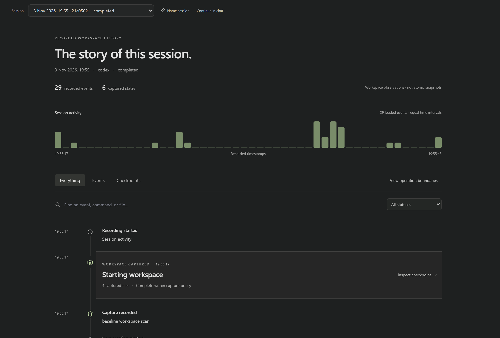
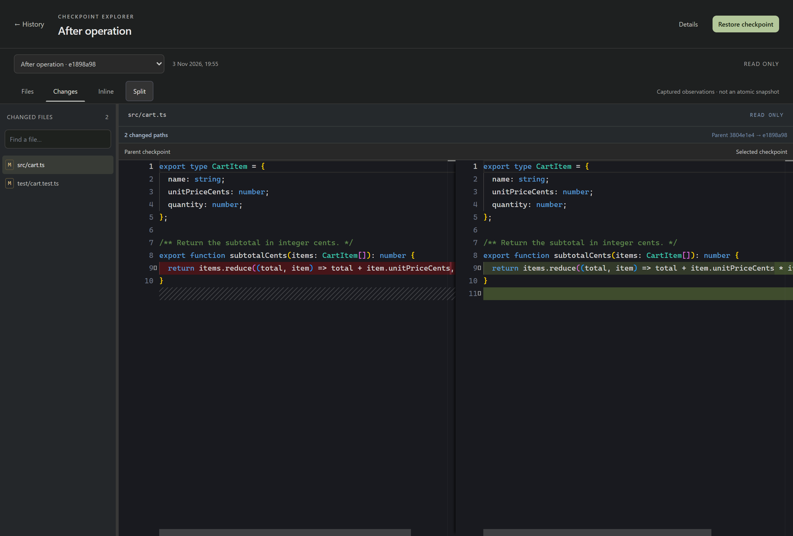

# Using AgentTM

This guide walks through recording a coding task, inspecting the saved files,
and restoring an earlier state without replacing your current workspace.
Use a disposable project for your first attempt.

- [Prepare your project](#1-prepare-your-project)
- [Record a task](#2-record-a-task)
- [Explore the dashboard](#3-explore-the-dashboard)
- [Read operation checkpoints](#4-read-operation-checkpoints)
- [Inspect files and changes](#5-inspect-files-and-changes)
- [Restore an earlier workspace](#6-restore-an-earlier-workspace)
- [Inspect history from the terminal](#7-inspect-history-from-the-terminal)
- [Use native desktop chat](#8-use-native-desktop-chat)
- [Back up history and manage storage](#9-back-up-history-and-manage-storage)
- [Handle failures and interruptions](#10-handle-failures-and-interruptions)

Already installed? Check `agenttm version`. Otherwise start with the
[installation instructions](../README.md#installation). This guide describes
the current implementation; check your release's notes and `agenttm help` for
available commands. Native chat and backup controls need the separate Windows
desktop app, not the CLI/browser dashboard.

## The terms you will see

| Term | Meaning |
| --- | --- |
| Project | The Git working tree currently opened in your terminal or native app. |
| Session | A managed CLI run, or a recorded desktop conversation that can contain several turns. |
| Event | A received message, tool notification, lifecycle update, or AgentTM observation. |
| Operation | A supported tool item with its recorded outcome and checkpoint coverage. |
| Checkpoint | Captured eligible file contents and metadata from a workspace observation. |
| Restored workspace / fork | A separate Git worktree populated with checkpoint files. It is not a rewind of the original conversation. |

## 1. Prepare your project

You need Git 2.42+ and an installed, authenticated Codex CLI for new recordings.
Go and Node.js are not required for prebuilt AgentTM binaries. Model requests use
your configured Codex account/service.

Open a terminal in the Git project you want to record. To create a disposable
example in Windows PowerShell:

```powershell
$demo = Join-Path $env:TEMP ('agenttm-guide-' + [guid]::NewGuid())
New-Item -ItemType Directory -Path $demo | Out-Null
Set-Location $demo
git init
Set-Content -LiteralPath message.txt -Value 'Version one' -Encoding UTF8
```

On Linux/macOS, create an empty directory, run `git init`, and create a text file
named `message.txt` containing `Version one`. An initial Git commit is not required.

Initialize AgentTM and check readiness:

```sh
agenttm init
agenttm codex doctor
agenttm doctor
```

`init` creates local history under `.agenttm` and excludes it through
`.git/info/exclude`; it does not commit your files. Run these commands inside
the project, not inside the directory where you extracted the AgentTM download.

If AgentTM is not on PATH, use its full executable path. In PowerShell a path
variable needs `&`, for example `& $agenttm init`. A desktop ZIP bundles the helper
as `agenttm-cli.exe`; see the native launch example below.

Resolve readiness errors before continuing. If Codex is absent, existing history
can still be opened, but recording a new model task will not work. See
[installation troubleshooting](installation.md#codex-and-first-run-diagnostics).

## 2. Record a task

From the example project's terminal:

```sh
agenttm run codex --sandbox workspace-write --snapshot-after-tool=true -- "Change message.txt to contain Version two followed by a newline. Do not change other files."
```

The quoted text is the task you want Codex to perform. AgentTM records only runs
launched through it; a separate `codex` terminal or editor conversation is not
passively captured. The explicit sandbox option permits project writes within
Codex's policy; it does not bypass approvals or guarantee every tool is allowed.

You should see a session UUID, a baseline checkpoint, event notifications, and a
final session status. After a successful edit, confirm `message.txt` contains
`Version two`. If it did not change, inspect the recorded tool outcomes; a
completed conversation is not proof every requested command succeeded.

If your configured model is unavailable, add `--model MODEL_ID` before `--`, using
a model available to your account. Do not paste `MODEL_ID` literally.

For an explanation-only task, use a prompt such as `Explain this project`.
No file differences and no supported operations can be normal for that task.

## 3. Explore the dashboard

```sh
agenttm ui
```

AgentTM opens a loopback URL, normally `http://127.0.0.1:7331`. Keep this terminal
running while using the browser. Ctrl+C stops the UI server; it does not delete
recorded history. If the port is busy, use `agenttm ui --port 7332`, or `--port 0`
to choose an available port. Use `--no-browser` to open the printed URL yourself.

Open **History**, then choose your recording. **Refresh history** reloads the
available history. If the UI is serving in one terminal, use a second terminal
opened at the same project path for additional commands; shell variables such
as `$demo` do not automatically carry into a new terminal.



| Screen or tab | What to do there |
| --- | --- |
| Overview | Find recent sessions and the next inspection step. |
| History | Explore chronological events and checkpoint milestones. Filter or expand observations for details. |
| History / Operation boundaries | Inspect supported operation outcomes and before/after capture coverage. |
| Inspect checkpoint / Files | Browse captured files in the dedicated Checkpoint Explorer. |
| Inspect checkpoint / Changes | Compare captured files with the checkpoint's manifest parent. |
| Checkpoint Explorer / Details | Open capture metadata when needed; closed by default. |
| Restored workspaces | Find the folders and branches created by checkpoint restoration. |
| Setup & help | Review setup and recording guidance. |

Chat with Codex and Storage & backups also appear in navigation; their native
actions require the Windows desktop app. A browser-only message explaining that
requirement is expected.

For longer recordings, **Session activity** shows counts in equal time buckets.
Click a populated bar to reveal and focus that segment of recorded history.
This resets the timeline filters; empty bins are disabled. The histogram is
hidden for fewer than 20 events or when all timestamps are identical.

Prompt, command, response, capture, and failure icons distinguish recorded
activity. Expand an event for diagnostic names and payloads. Adjacent events
share a collapsible group only when their recorded identifiers match; failures
and checkpoint milestones stay visible. **Compare with previous** opens the
recorded parent comparison when that parent is present in loaded checkpoints.

## 4. Read operation checkpoints

Open **History**, choose your session, then select **View operation boundaries**. Each card separates the tool's reported
outcome from its capture status. **Inspect before** and **Inspect after** open
the corresponding historical files when those states exist. Use **Refresh
operations** to reload the list during or after a run.

| Capture indicator | How to interpret it |
| --- | --- |
| Complete | The boundary capture finished; this covers eligible files, not excluded files or external state. |
| Partial | Some files were omitted or a scan was potentially inconsistent. Review the selected checkpoint's warnings. |
| Missing start | No start notification was recorded, so no before state is inferred. |
| Pending | The operation record has not yet been finalized; a force-killed recorder can leave it pending. |
| Interrupted / failed | Coverage is incomplete. Inspect the session and run `agenttm doctor`. |
| Disabled | Operation snapshots were disabled for that recording; metadata may still be present. |
| Overlapping operations | Other operations may have contributed to the observed files. |

A failed tool can still have an after checkpoint. A no-op operation still gets
its own completion checkpoint, while identical file bytes remain deduplicated.

Notifications do not pause Codex or other writers. An edit can already have
happened when a start notification is processed. Before/after links are workspace
observations, not proof of which action introduced a line. A zero changed-path
count does not establish that no intermediate edit occurred. See
[checkpoint guarantees](granular-checkpoints.md).

## 5. Inspect files and changes

Choose **Inspect checkpoint** on a History milestone to open the dedicated
Checkpoint Explorer. Its file panel is resizable; Details starts closed.



Choose a baseline checkpoint in **Files**, then select `message.txt`. In the
example it should show `Version one`. Select a checkpoint that captured the edit
to inspect `Version two`. The editor is read-only; viewing an old file does not
replace the working copy.

**Changes** compares the selected checkpoint with its parent, not necessarily
with the session baseline or an overlapping operation's before state. A final
checkpoint may reuse an existing state, and a no-op checkpoint can have an empty
diff. Select an earlier changed checkpoint if the last one shows no differences.

If a timeline event has no checkpoint, the UI can label a preceding state as
**Last known workspace**. That is not a new snapshot of the selected event.
Review partial-snapshot omissions before relying on a historical tree. Git-ignored
files, excluded paths, oversized files, and external services may not be captured.

## 6. Restore an earlier workspace

To explore the baseline without overwriting `Version two` in the original project:

1. Select the baseline and inspect its files first.
2. Choose **Restore checkpoint**.
3. Enter a unique name such as `before-edit`.
4. Review the destination, branch, and any partial-snapshot warnings. Consent to
   a partial restore only if you understand which files will be missing.
5. Choose **Create restored worktree**.
6. Open **Restored workspaces** to find the recorded folder location, then open
   that folder in your editor.

The restored `message.txt` should contain `Version one`, while the original
project's file still contains `Version two`. AgentTM creates a worktree under
`.agenttm/worktrees/` with a branch such as `agenttm/before-edit`. Its files may
be dirty relative to the recorded Git commit; restoration does not automatically
create a commit or execute the restored code.

Inspect and test the restored copy before bringing any changes back through your
normal Git workflow. This restores captured files, not the agent's conversation,
dependencies, ignored files, credentials, or external environment. Do not expect
**Continue in chat** to move a conversation into the restored directory.

### Manage restored workspaces

Open **Restored workspaces** for a compact list of recorded restores. Search by
folder name, path, branch, or checkpoint; sort by date, name, or restore result.
Search and sorting cover loaded records; use **Load more workspaces** when shown.
Select a row to see its full location, branch, source checkpoint, and recorded
date. Small windows open the details as a drawer; Escape closes it.

- **Copy path** copies the recorded location; **Inspect source checkpoint** opens
  the source in Checkpoint Explorer, with any missing-data error shown explicitly.
- In updated Windows source builds, **Check folder** checks whether the recorded
  directory is currently accessible. Missing or moved folders remain in the ledger;
  they are not silently removed or relocated.
- **Open folder** rechecks the record and requests Windows File Explorer. The
  native action accepts a project-scoped restore ID, not a caller-supplied path.
  Browser users can copy the path and open it manually instead. VS Code launching
  and workspace deletion are not implemented here.

**Completed** means the restore ledger recorded success. Folder accessibility is
a separate, on-demand check: it does not verify Git registration or current file
integrity. These actions never restore into the original working tree or rewind
its Codex conversation.

## 7. Inspect history from the terminal

Use a terminal in the same project. Copy full UUIDs from the command output,
replacing the example values below; do not use the dashboard's shortened labels.

```powershell
agenttm sessions
$session = 'PASTE-THE-FULL-SESSION-UUID'
agenttm events $session
agenttm operations $session
agenttm checkpoints $session

$checkpoint = 'PASTE-THE-FULL-CHECKPOINT-UUID'
agenttm show $checkpoint
agenttm cat $checkpoint message.txt
agenttm diff $checkpoint
```

`show` includes file eligibility/omission metadata; `cat` reads verified historical
contents; `diff` compares against the checkpoint's parent. On Linux/macOS, pass
the same full IDs directly or use your shell's variable syntax.

For a manually observed state after an existing recording:

```powershell
agenttm checkpoint $session
```

This scans the workspace **now**. It does not reconstruct an unrecorded past edit.

To restore through the CLI instead of the dashboard:

```powershell
agenttm fork $checkpoint --name before-edit-cli
agenttm forks
```

If the checkpoint is partial, the command requires explicit `--allow-partial`
consent. Check omissions before adding that flag. The CLI restore creates the
worktree after its checks; unlike the UI dialog, it does not wait for a second
interactive confirmation. Full flags and pagination: [CLI reference](cli.md).

## 8. Use native desktop chat

Use this path when you want to send messages inside AgentTM rather than launching
each task from a terminal. Download the separate desktop ZIP if your selected
release provides it. WebView2 is required. From the extracted app folder:

```powershell
$appDir = (Get-Location).Path
Set-Location 'C:\path\to\your\git-project'
& (Join-Path $appDir 'agenttm-cli.exe') init
& (Join-Path $appDir 'AgentTM.exe')
```

Replace the example project path with your real Git project. In v0.3.3 the working
directory selects the project. Source builds after v0.3.3 also support a welcome
screen: double-click the app outside an initialized project, choose **Open a Git
project**, select your folder, and confirm history initialization if requested.
See [desktop setup](desktop-onboarding.md) for prerequisites and first-launch help.

In **Chat with Codex**:

1. Use the plus button for **New conversation**, or the history icon to choose
   a saved conversation. Choose an available model in the composer toolbar.
2. Start with **Read only** for explanations. Select **Allow project edits** when
   you intend Codex to change project files.
3. Send your task with the arrow button or **Ctrl+Enter**. Enter adds a newline.
   Review any supported tool-approval prompts using **Allow once**
   or **Decline**; **Stop turn** requests interruption.
4. Use **View history** to inspect the recorded session and captured checkpoints.
   Failed tool details open automatically; other tool details can be expanded.
   If you scroll up during a reply, **Latest messages** returns to the bottom.

If model discovery fails, open **Model settings**, refresh models, or choose the
installed Codex executable directly. Listing a model does not guarantee account
access; choose a different model if the request is rejected.

To follow up, select the saved conversation or choose **Continue in chat** from
a resumable session. This resumes its saved Codex thread and needs Codex's own
local thread history and account access. It is not a checkpoint-based rewind or
an unattended continuation loop. Prompt text capture is off by default, so a
reopened conversation can display prompt placeholders; Codex retains its separate
conversation history.

## 9. Back up history and manage storage

In the native app, open **Storage & backups**. To create an encrypted history
backup, choose **Create backup** to open its dedicated dialog. Enter and confirm
a passphrase of at least 12 characters, then choose
**Create encrypted backup** and a new `.age` file outside `.agenttm`. Keep the
passphrase separately; AgentTM cannot recover a forgotten one.

Restoration needs the existing backup/passphrase and a Git clone with **no existing
`.agenttm` directory**. Choose **Restore backup**, enter the archive passphrase, then choose
**Choose archive & target**. Select the archive and destination in the native dialogs,
and review the native confirmation. The archive is validated before history is
published; an existing history store is not overwritten.

The Local history summary measures regular-file sizes under .agenttm, excluding
restored worktrees. Its disjoint categories include blob storage, the SQLite
database and sidecar files, manifests, logs, and other history files. These are
logical bytes, not allocated disk space; exported archives outside .agenttm are
not counted. If measurement is unavailable, the UI shows no made-up totals.

History backups do not include Git history, your current workspace, restored
worktrees, or Codex credentials/thread files. Back those up separately. An AgentTM
history restore is not a complete runnable-project or conversation-history backup.

For **Storage Cleanup**, first choose **Preview Cleanup**. Referenced checkpoint files
are preserved; default cleanup candidates must be unreferenced and at least 24
hours old. Cleanup refuses active recordings or unsafe/corrupt storage. The CLI
preview is also available:

```sh
agenttm gc
```

The preview does not delete anything. Review its eligible counts and size, check
the explicit consent box, then use **Delete previewed blobs**. A failed or changed
preview must be refreshed before retrying. Deletion errors may leave a partially
completed cleanup; never infer that no files were removed.

Removing an old session is a separate,
destructive action; it removes its inspection history and cannot be undone
without a suitable backup. Read [chat and storage](chat-and-storage.md) and
the [CLI reference](cli.md) before applying cleanup or purging a session.
Do not delete `.agenttm` or arbitrary object files to make one recording work.

### Open another project

Select your project name in the sidebar to open **Your workspace**. The location
row shows the current project path; use its copy icon to copy it. A failed path
read offers **Retry project path**.

In the Windows desktop app, **Choose a Git project...** opens a folder picker.
Select an existing Git working tree. AgentTM requests a separate window for that
folder and asks for initialization there if it has no local history. Canceling
leaves the current workspace unchanged. This does not move the current recording
or history to the other project. If an error appears, correct it and choose again.

In the browser, run `agenttm ui` from the other project's terminal instead.

### Settings and Setup Guide

**Settings** shows loaded project configuration, environment diagnostics, and the
running AgentTM version. Prompt capture is displayed read-only; this page does
not introduce a new preference switch. **Check again** reruns supported checks.
Codex readiness covers its version, JSON execution support, and observable sign-in;
Git availability/root validity and history API readability have separate statuses.
Unverified checks remain unverified, especially in a browser or older native build.
A readable database is not a full storage-integrity result, and model access and
tool execution are confirmed only by a real task.

Open **Setup guide** from the toolbar or Settings for instructions. The original
five onboarding steps cover the project, installation, sign-in, and a first run.
The reference sections **History basics**, **Capture & limits**, and **Restore
safely** explain recorded events, eligible files and omissions, comparisons, and
isolated restoration. Commands have Copy buttons. Escape closes the guide and
returns keyboard focus to its opener.

## 10. Handle failures and interruptions

| Situation | What to check |
| --- | --- |
| Nothing appears in history | Confirm the task was launched through AgentTM in this Git project, then refresh history. |
| No changed files | An explanation can produce no edits. Otherwise inspect failed/declined tool events and Codex permissions. |
| Empty final diff | Select a changed boundary checkpoint; the last checkpoint can have an unchanged parent state. |
| Files are missing | Read the checkpoint's omissions and [snapshot eligibility rules](snapshots.md). |
| Codex/model setup error | Use [installation diagnostics](installation.md#codex-and-first-run-diagnostics); do not bypass its approval/sandbox policy. |
| Partial or interrupted capture | Inspect operation coverage and run `agenttm doctor`; do not assume missing states can be reconstructed. |
| Recorder was force-killed | Active/pending records or locks can remain. Follow [recovery guidance](fork-and-recovery.md), confirming no recorder is using a lock before removing it. |
| Restore failed | The recorded restore folder can remain for diagnosis. Inspect its status and the recovery guide before reusing it. |

Ctrl+C during CLI recording or **Stop turn** in desktop requests cancellation and
attempts final capture. Force-killing a process or losing power has weaker cleanup
guarantees. `doctor` can report healthy local storage but still return nonzero
because Codex authentication/readiness failed; read the diagnostic text.

AgentTM stores history locally, but Codex communicates with its configured service.
Event sanitization is best-effort and captured file bytes are not content-redacted.
Avoid sensitive projects for initial experiments, and review recordings before
sharing them. Report bugs with your AgentTM version, OS, and sanitized reproduction
steps through [Issues](https://github.com/Jyotishmoy12/AgentTM/issues).
